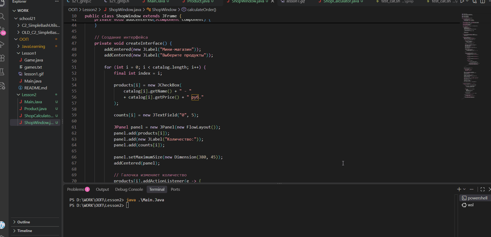

# Урок 2. Мини-магазин

## Описание проекта

«Мини-магазин» — графическое приложение на Java для расчёта стоимости покупки.

## Возможности приложения

- Выбор товаров: хлеб, молоко, колбаса.
- Указание количества каждого товара.
- Автоматическая синхронизация количества и флажков выбора товаров.
- Выбор пакета: маленький, большой или без пакета.
- Применение промокода `SHOP10` для скидки 10% на товары.
- Расчёт итоговой стоимости с учётом скидки и пакета.
- Проверка корректности введённого количества.

## Структура проекта

- `Main.java` — запуск приложения.
- `Product.java` — хранение названия и цены товара.
- `ShopCalculator.java` — расчёт стоимости покупки.
- `ShopWindow.java` — создание графического интерфейса и обработка действий пользователя.

## Демонстрация работы

