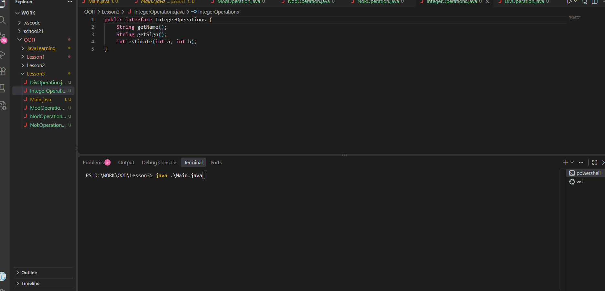

## Урок 3. Принципы ООП в Java

## Описание

Консольное Java-приложение для выполнения четырёх целочисленных бинарных операций:

- **DIV** — целочисленное деление.
- **MOD** — остаток от деления.
- **НОД** — наибольший общий делитель.
- **НОК** — наименьшее общее кратное.

## Структура проекта

| Файл | Назначение |
|---|---|
| `IntegerOperations.java` | Интерфейс, определяющий методы операций |
| `DivOperation.java` | Целочисленное деление |
| `ModOperation.java` | Вычисление остатка от деления |
| `NodOperation.java` | Вычисление НОД алгоритмом Евклида |
| `NokOperation.java` | Вычисление НОК через НОД |
| `Main.java` | Создание объектов операций и вывод результатов |

## Реализация ООП

Интерфейс `IntegerOperations` содержит три метода:

- `getName()` — возвращает название операции.
- `getSign()` — возвращает обозначение операции.
- `estimate(int a, int b)` — принимает два целых числа и возвращает результат вычисления.

Каждая операция реализована отдельным классом с помощью `implements IntegerOperations`.

В `Main.java` используется массив `IntegerOperations[]`, который содержит объекты разных классов. Благодаря полиморфизму все операции вызываются одинаково, через методы общего интерфейса.

## Демонстрация

